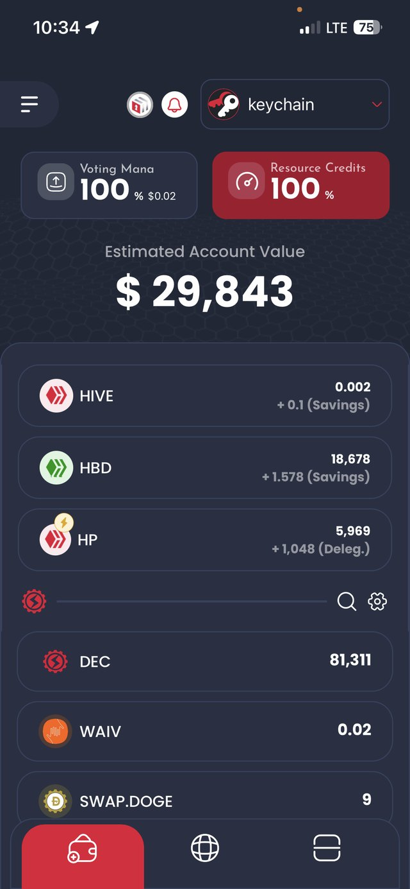

<p align="center">
  
</p>

<h1 align="center">Hive Keychain</h1>

<p align="center">
  <strong>One wallet for Hive and every EVM chain.</strong>
</p>

<p align="center">
  
  &nbsp;&nbsp;
  
</p>

Hive Keychain is a free, open source, self-custodial wallet for Hive plus
Ethereum, Base, BNB Chain, Polygon, Avalanche, Arbitrum, Optimism and any EVM
network you add. Hold and send assets, swap, buy, sign transactions and connect
to dApps, in your browser or on mobile. Your keys stay on your device.

Get it at [hive-keychain.com](https://hive-keychain.com) or directly from the
[Chrome Web Store](https://chrome.google.com/webstore/detail/hive-keychain/jcacnejopjdphbnjgfaaobbfafkihpep?hl=en),
[Firefox Add-ons](https://addons.mozilla.org/en-US/firefox/addon/hive-keychain/),
[App Store](https://apps.apple.com/us/app/hive-keychain/id1552190010) and
[Google Play](https://play.google.com/store/apps/details?id=com.mobilekeychain).

This repository is the source of the landing page at
[hive-keychain.com](https://hive-keychain.com).

## Run it

Requires Node.js 18 or newer.

```bash
npm install
npm run dev       # start the dev server
npm run build     # production build into dist/
npm run preview   # serve the production build locally
npm run deploy    # build and publish dist/ to the gh-pages branch
```

Routes are real paths: `/terms`, `/privacy`, `/fees`, and `/invoice/<payload>`.
Older hash URLs (`#/terms`, `#/privacy`, `#/fees`, `#/`, and `#invoice/...`)
open the same pages and are rewritten to those paths. In-page sections stay
hash links (`/#download`).

`npm run deploy` adds a `404.html` fallback and a `CNAME` for
`hive-keychain.com`, then pushes `dist/` to the `gh-pages` branch. GitHub Pages
serves that file for the paths above so the app can read them. Any other static
host needs the same single-page fallback.

## License

[MIT](LICENSE) © 2026 Hive Keychain Ltd.
